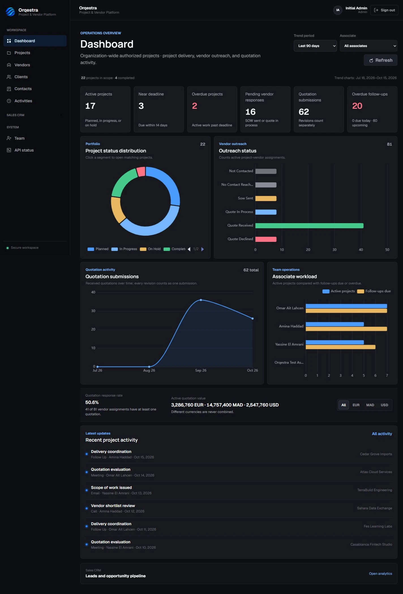
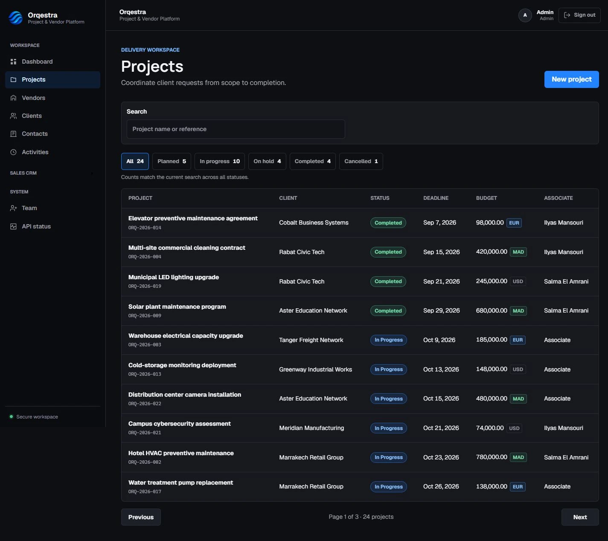
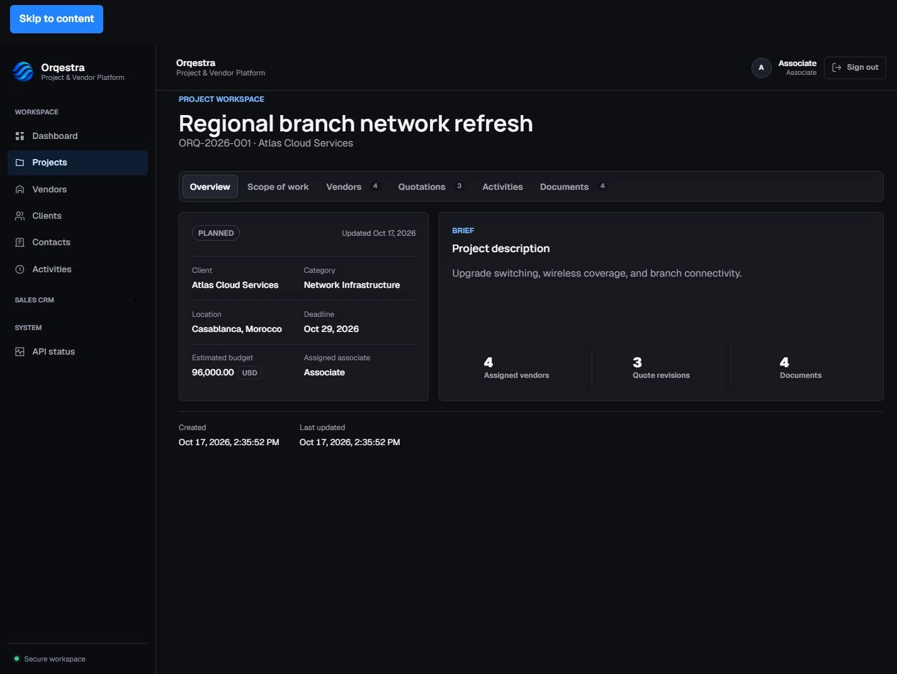
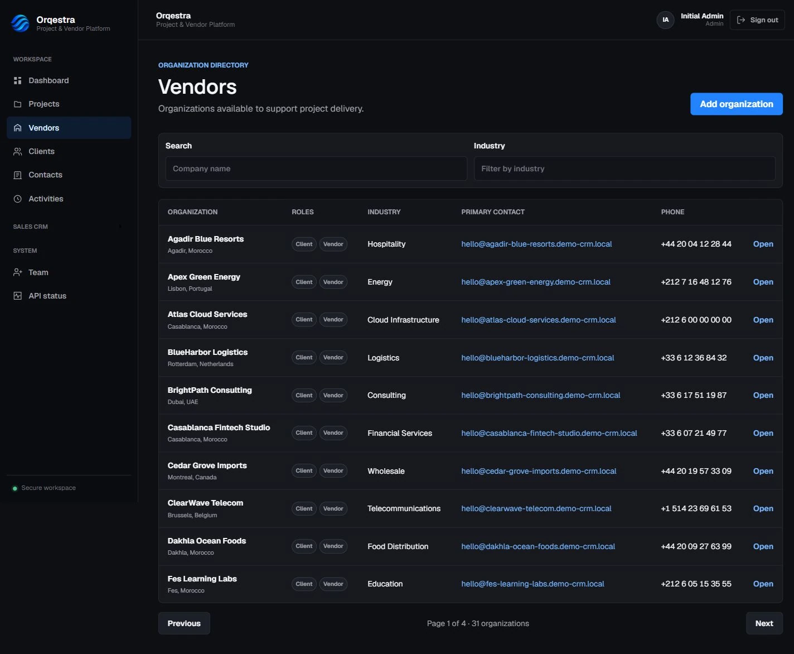
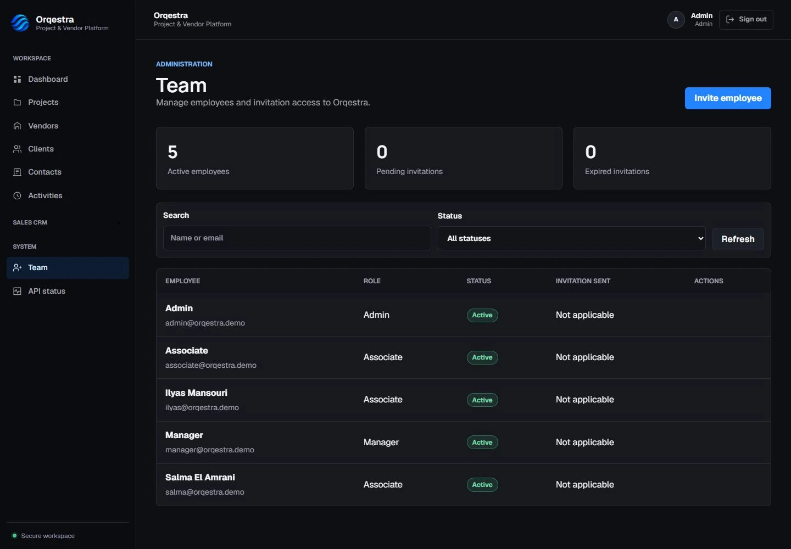
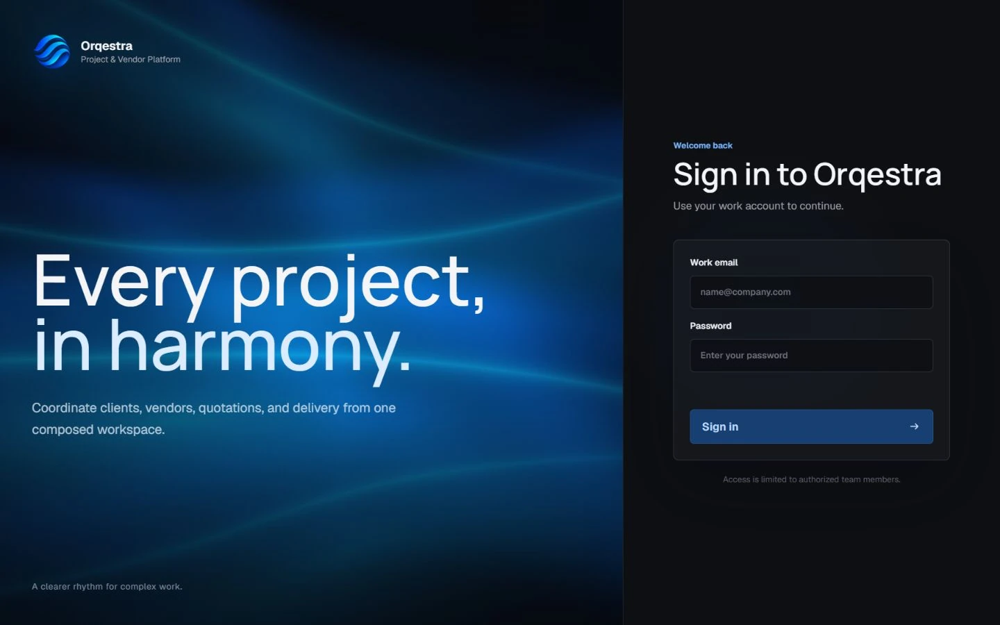
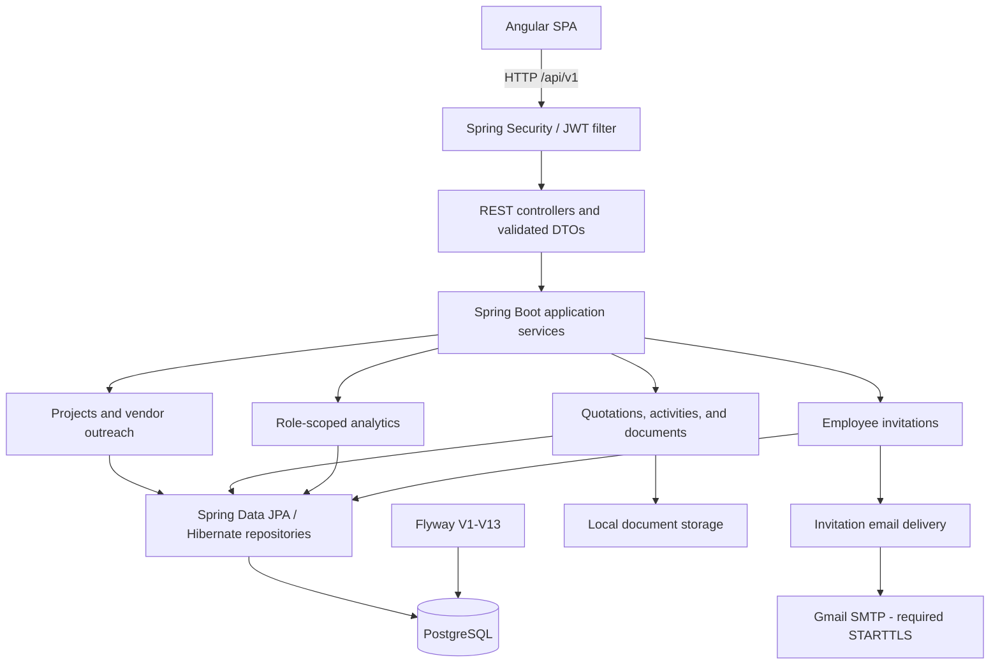

# Orqestra

**Project & Vendor Platform**

*Every project, in harmony.*

A full-stack B2B workspace for coordinating client projects, vendor outreach, quotations, documents, and employee responsibilities. Built with Spring Boot, Angular, and PostgreSQL, with server-side authorization throughout the project workflow.



## Overview

Orqestra brings project delivery and supplier coordination into one workspace. Teams can connect a client request to a project, assign an associate, follow vendor responses, compare quotation revisions, and keep communication and supporting documents alongside the work.

Clients and vendors share one organization model: a company can have either role or both. Existing contacts, leads, opportunities, and sales analytics remain available through the secondary Sales CRM navigation.

## Core Features

| Area | Implemented capabilities |
| --- | --- |
| **Projects** | Create, search, filter, and paginate projects. Track reference, client, category, location, deadline, budget, currency, assigned associate, status, Scope of Work, and notes. |
| **Vendors** | Search the vendor directory, associate vendors with projects, assign responsible associates, update outreach status, and track contact dates, follow-ups, and notes. |
| **Quotations** | Record quotations from multiple vendors, retain numbered revisions, compare amounts and currencies, and select or replace the winning quotation transactionally. Quote updates can mark vendor outreach as Quote Received. |
| **Activities** | Record notes, calls, emails, meetings, and follow-ups. View project communication timelines and upcoming or overdue vendor follow-ups. |
| **Documents** | Upload project files and quotation attachments, list file metadata, and download through authorized API endpoints. Files use local filesystem storage; metadata is persisted in PostgreSQL. |
| **Analytics** | ECharts visualizations for project status, vendor outreach, quotation trends, and associate workload. Date-range, associate, and currency controls where applicable; unlike currencies are kept separate. |
| **Authentication** | JWT login, BCrypt password hashing, protected Angular routes, and Spring Security authorization. Associates see assigned-project data and role-scoped analytics. |
| **Employee onboarding** | Admin-only Team Management, Manager/Associate invitations, Gmail SMTP emails, password setup through single-use activation links, expiry, resend, revocation, and delivery failure tracking. |

The interface uses a shared dark design system, Manrope headings, Geist inputs and body text, and a lazy-loaded Three.js login scene with reduced-motion and WebGL fallbacks.

## Screenshots

Captured from the running application using existing synthetic development records. The Team view is filtered to the demo email domain.

| Projects | Project Details |
| --- | --- |
|  |  |

| Vendors | Team Management |
| --- | --- |
|  |  |

<details>
<summary>Interactive login experience</summary>



</details>

## Tech Stack

| Layer | Technologies |
| --- | --- |
| Backend | Java 17, Spring Boot 3.3.5, Spring Security, Spring Data JPA / Hibernate, Jakarta Validation |
| Persistence | PostgreSQL, Flyway migrations V1-V13 |
| Frontend | Angular 16.2.12, TypeScript 5.1.6, Angular Router, Reactive Forms, RxJS |
| Visualization | ECharts 6.1.0, Three.js 0.186.1 |
| Typography | Locally bundled Manrope and Geist variable fonts |
| Email and security | Spring Boot Mail, Gmail SMTP with required STARTTLS, JWT, BCrypt |
| Build and testing | Maven, pnpm, JUnit 5, Spring Boot Test, Mockito, Jasmine, Karma |
| Source control | Git and GitHub |

## Architecture

The backend is a modular monolith organized by business capability. REST controllers accept validated DTOs; Spring Security checks authentication, and application services enforce ownership and role rules. Spring Data repositories persist the relational model through Hibernate.

The Angular application is organized by feature, with shared authentication services, route guards, and an HTTP interceptor. Dashboard and authentication experiences are lazy-loaded.



Invitation hashes and lifecycle state are persisted before email delivery. SMTP runs outside the invitation transaction; failures remain visible for safe retry. Account creation and token consumption execute atomically with a database row lock.

## Business Workflow

```mermaid
flowchart LR
    Request["Client request"] --> Project["Create project and Scope of Work"]
    Project --> Associate["Assign associate"]
    Associate --> Outreach["Assign vendors and track outreach"]
    Outreach --> SOW["Record SOW Sent status"]
    SOW --> Quotes["Record quotations and revisions"]
    Quotes --> Selection["Admin or Manager selects quotation"]
    Selection --> Progress["Track project progress"]
    Progress --> Updates["Activities, follow-ups, and documents"]
```



This diagram describes user-driven work, not an automatic approval engine. SOW Sent is an outreach status; project progress and outreach dates are maintained by users. Quotation recording and selection apply the implemented quotation/outreach status updates.

## Role-Based Permissions

Authorization is enforced in backend services and the Spring Security filter chain. Angular visibility and route guards provide an additional UI boundary.

| Capability | Admin | Manager | Associate (`SALES_REP`) |
| --- | --- | --- | --- |
| Browse client/vendor directories | Yes | Yes | Yes |
| Create/update organizations | Yes | Yes | No |
| Delete organizations | Yes, subject to relationship checks | No | No |
| View projects and operational analytics | Organization-wide | Organization-wide | Assigned projects / own scope |
| Create/delete projects; add/remove project vendors | Yes | Yes | No |
| Update vendor outreach and record quotations | Yes | Yes | Within assigned projects; cannot reassign vendor work |
| Select or replace winning quotation | Yes | Yes | No |
| Access project documents and activities | Authorized organization-wide scope | Authorized organization-wide scope | Assigned-project scope |
| List employees; invite, resend, revoke | Yes | No | No |

## Local Development

### Prerequisites

- JDK 17 and Maven 3.9+
- Node.js 18.x or 20.x and pnpm; the package declares Node `>=16.14.0 <21.0.0`
- PostgreSQL, with version 16 matching the included Compose database image

### 1. Clone and Configure PostgreSQL

```bash
git clone https://github.com/youssefsaoud/enterprise-crm-platform.git
cd enterprise-crm-platform
```

Run as a PostgreSQL administrator on a fresh local installation, choosing your own password:

```sql
CREATE USER crm_app WITH PASSWORD 'replace-with-your-local-password';
CREATE DATABASE crm_dev OWNER crm_app;
```

Use an existing database/user when already configured.

### 2. Configure the Backend

Use [`.env.example`](.env.example) as the configuration reference. In a fresh checkout, create an ignored root `.env.local`:

```powershell
# PowerShell
if (!(Test-Path .env.local)) { Copy-Item .env.example .env.local }
```

```bash
# macOS / Linux
cp -n .env.example .env.local
```

Set each key once, removing duplicate definitions if copied from the example:

| Key | Local configuration |
| --- | --- |
| `CRM_DB_URL` | `jdbc:postgresql://localhost:5432/crm_dev` |
| `CRM_DB_USERNAME`, `CRM_DB_PASSWORD` | Your database user and password |
| `CRM_JWT_SECRET` | A securely generated signing secret of at least 32 characters |
| `CRM_CORS_ALLOWED_ORIGIN` | `http://localhost:4200` |
| `CRM_BOOTSTRAP_ADMIN_ENABLED` | `true` only to create the first development Admin when none exists |
| `CRM_BOOTSTRAP_ADMIN_EMAIL`, `CRM_BOOTSTRAP_ADMIN_PASSWORD` | Your chosen initial Admin credentials |
| `FRONTEND_BASE_URL` | `http://localhost:4200` for local activation links |

The default `dev` profile **explicitly imports** `.env.local` as a Spring properties file from the current working directory or its parent. Launching from `backend/` therefore loads the root file. Use plain `KEY=value` entries without shell `export` prefixes or surrounding quotes. Process environment variables are also supported. Other profiles must receive configuration through environment variables or Spring configuration.

Disable Admin bootstrap after the initial setup. No public signup is available.

### 3. Run the Application

In one terminal, from the repository root:

```bash
cd backend
mvn spring-boot:run
```

Flyway applies migrations automatically, and Hibernate validates the schema. Do not edit migrations already applied to a database.

In another terminal:

```bash
cd frontend
pnpm install --frozen-lockfile
pnpm start
```

| Service | URL |
| --- | --- |
| Angular application | http://localhost:4200 |
| Spring Boot API | http://localhost:8080/api/v1 |
| Public API health check | http://localhost:8080/api/v1/health |

Angular's development proxy forwards `/api` requests to port 8080. The configured API URL lives in `frontend/src/environments/`.

Uploaded files default to `${user.home}/.crm/uploads`. Override `crm.documents.storage-path` through Spring configuration when needed, and preserve that directory alongside the database.

### 4. Configure Invitations

Set `SMTP_USERNAME` to your dedicated Gmail sender and `SMTP_PASSWORD` to its Google app password. The backend uses `smtp.gmail.com:587`, authentication, required STARTTLS, certificate verification, and network timeouts.

- `INVITATION_DELIVERY_MODE=smtp` enables real email submission.
- `INVITATION_TTL_HOURS=24` sets the default link lifetime.
- For local preview without sending mail, use `INVITATION_DELIVERY_MODE=preview` and `INVITATION_PREVIEW_ENABLED=true` with the `dev` profile. The Admin-only `GET /api/v1/admin/invitations/{id}/preview` endpoint serves an ephemeral preview.
- Admins invite Managers or Associates from **Team**. Resending rotates the token; revocation invalidates the invitation.
- SMTP submission is recorded separately from acceptance and does not guarantee inbox delivery.

Keep `.env.local` and credentials out of Git. Invitation endpoints use request limits, and PostgreSQL stores token hashes rather than plaintext tokens.

### Container Assets

The repository also includes Dockerfiles, an nginx frontend configuration, and `docker-compose.yml` for PostgreSQL, API, and frontend services. The local setup above is the primary development path. Compose activates the `prod` profile and does not currently forward SMTP variables or mount document storage; configure those explicitly before using invitation or persistent-file workflows in containers.

## Testing

Run backend tests from `backend/`:

```bash
mvn test
```

The suite includes Spring security tests and invitation lifecycle tests using real HTTP requests and temporary records. A local `crm_dev` database must be available and configured. Routine email tests use mocked delivery; the SMTP connectivity test is opt-in.

Run frontend tests and the production build from `frontend/`:

```bash
pnpm test -- --browsers=ChromeHeadless
pnpm build
```

Karma requires an installed Chromium browser. To use Microsoft Edge on Windows:

```powershell
$env:CHROME_BIN = "C:\Program Files (x86)\Microsoft\Edge\Application\msedge.exe"
pnpm test -- --browsers=ChromeHeadless
```

Frontend coverage includes authentication routing, Admin-only navigation, invitation forms, activation states, and existing CRM components. Backend coverage includes validation, ownership, quotation workflows, invitation expiry/revocation/reuse, concurrent acceptance, token rotation, and delivery failure handling.

## Project Status

Orqestra is an actively developed, functional portfolio project. Project/vendor workflows, operational analytics, and employee onboarding run locally with PostgreSQL persistence. Local development is the primary demonstration workflow.
