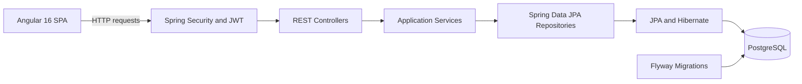
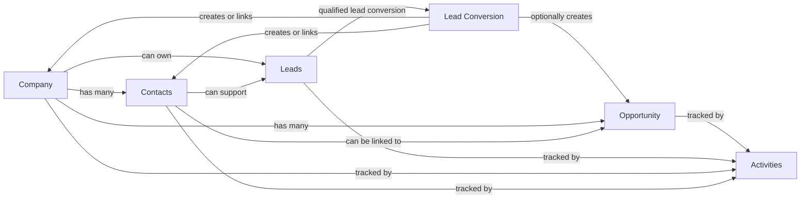

# Enterprise CRM Platform

A full-stack CRM application built with Spring Boot, Angular, and PostgreSQL. It demonstrates secure REST API design, JWT authentication, role-based authorization, Flyway-managed schema evolution, and a modern Angular single-page interface for managing sales and customer relationship workflows.

[](https://www.oracle.com/java/)
[](https://spring.io/projects/spring-boot)
[](https://angular.io/)

## At a Glance

| Area | Summary |
| --- | --- |
| Purpose | Manage companies, contacts, leads, opportunities, interactions, and CRM dashboard analytics. |
| Backend | Java 17, Spring Boot 3.3.5, Spring Security, Spring Data JPA, Hibernate, Flyway. |
| Frontend | Angular 16, TypeScript, Angular Router, HttpClient, Reactive Forms. |
| Database | PostgreSQL with versioned Flyway migrations. |
| Security | JWT login, BCrypt password hashing, protected routes, and backend-enforced role checks. |
| Testing | JUnit 5, Spring Boot Test, Mockito, Jasmine, Karma. |
| Runtime | Local development, Docker Compose, and nginx-served Angular build. |

## Core Features

- Secure login with JWT-based authentication and current-user lookup.
- Role-based access for `ADMIN`, `MANAGER`, and `SALES_REP` users.
- Company and contact management with search, filtering, pagination, and soft deletion.
- Lead capture, assignment, status changes, event history, and conversion workflow.
- Lead conversion into company/contact records with optional opportunity creation.
- Opportunity pipeline management with owner changes, stage changes, values, currencies, and expected close dates.
- Activity tracking for notes, calls, emails, and meetings across CRM records.
- Dashboard metrics for lead status, open opportunities, pipeline value, and recent activity.
- Global API error handling for validation, conflicts, access denial, and missing resources.
- Angular route guards, HTTP interceptor, protected feature pages, and API status view.

## System Architecture



## CRM Workflow



## Architecture Overview

The backend is a modular monolith. Business capabilities are separated by package, with controllers handling HTTP requests, services enforcing business rules and authorization, repositories handling persistence, and DTOs shaping API input/output.

The Angular frontend is organized by feature area and uses shared core services for authentication, route protection, API access, and HTTP token handling. The local development server proxies `/api` requests to the Spring Boot backend.

## Project Structure

| Path | Purpose |
| --- | --- |
| `backend/` | Spring Boot REST API, security configuration, services, repositories, entities, migrations, and tests. |
| `frontend/` | Angular application with routed CRM feature pages and API clients. |
| `backend/src/main/resources/db/migration/` | Flyway migrations for PostgreSQL schema management. |
| `frontend/src/app/core/` | Angular authentication, route guards, interceptor, and API helpers. |
| `frontend/src/app/features/` | Dashboard, companies, contacts, leads, opportunities, activities, login, and status pages. |

## Main API Areas

| Area | Implemented Capabilities |
| --- | --- |
| Auth | Login and current-user lookup. |
| Admin | User provisioning. |
| Companies | CRUD, search, filtering, pagination, soft delete. |
| Contacts | CRUD, company relationship, search, pagination. |
| Leads | CRUD, assignment, status updates, history, conversion. |
| Opportunities | CRUD, pipeline summary, owner updates, stage transitions. |
| Interactions | Activity creation, search, update, delete, and record-specific timelines. |
| Dashboard | Lead status metrics, open pipeline value, recent activity. |
| Health | Public API health check. |

## Local Setup

### Prerequisites

- JDK 17 or newer
- Maven 3.9 or newer
- PostgreSQL 14 or newer
- Node.js 16.14 through 20.x
- pnpm

### 1. Clone the Repository

```bash
git clone https://github.com/youssefsaoud/enterprise-crm-platform.git
cd enterprise-crm-platform
```

### 2. Configure PostgreSQL

Create a local database and application user. Use your own secure password.

```sql
CREATE DATABASE crm_dev;
CREATE USER crm_app WITH PASSWORD 'replace-with-your-password';
GRANT ALL PRIVILEGES ON DATABASE crm_dev TO crm_app;
```

Set the required environment variables in your local shell or a Git-ignored local environment file.

```env
CRM_DB_URL=jdbc:postgresql://localhost:5432/crm_dev
CRM_DB_USERNAME=crm_app
CRM_DB_PASSWORD=replace-with-your-password
CRM_CORS_ALLOWED_ORIGIN=http://localhost:4200
CRM_JWT_SECRET=replace-with-a-long-random-secret
CRM_BOOTSTRAP_ADMIN_ENABLED=true
CRM_BOOTSTRAP_ADMIN_EMAIL=admin@example.com
CRM_BOOTSTRAP_ADMIN_PASSWORD=replace-with-admin-password
```

Do not commit local secrets.

### 3. Run the Backend

```bash
cd backend
mvn spring-boot:run
```

The API runs at `http://localhost:8080`. Flyway applies database migrations automatically on startup.

### 4. Run the Frontend

```bash
cd frontend
pnpm install
pnpm start
```

The Angular app runs at `http://localhost:4200` and proxies `/api` requests to the backend.

## Testing and Build

```bash
cd backend
mvn test
```

```bash
cd frontend
pnpm test
pnpm run build
```

## Docker Compose

The repository includes Docker assets for PostgreSQL, the Spring Boot API, and an nginx-served Angular frontend.

```bash
docker compose build
docker compose up -d
```

Required runtime secrets such as database and JWT values should be supplied through environment variables.

## Why This Project Matters

This project shows practical full-stack engineering work: secure authentication, relational modeling, schema migrations, backend authorization, RESTful APIs, frontend route protection, dashboard queries, and containerized deployment assets in a single maintainable codebase.
