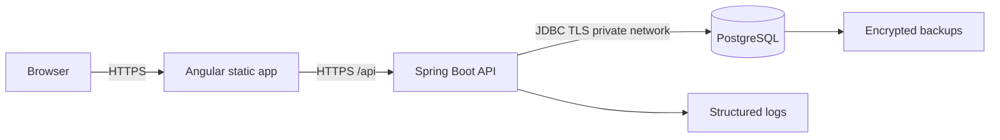

# Deployment Guide

This guide documents the final MVP deployment approach for the Spring Boot, Angular, and PostgreSQL CRM.

## Platform decision

The MVP can be deployed on a simple container platform:

- Spring Boot API: containerized service running the `backend/Dockerfile` image.
- Angular frontend: static files served by nginx from the `frontend/Dockerfile` image.
- PostgreSQL: managed PostgreSQL where available; local Docker volume only for rehearsals.

This keeps the deployment reproducible while avoiding early complexity such as Kubernetes or multi-region infrastructure.

## Public endpoints

- Frontend: `https://crm.example.com`
- API: `https://api.crm.example.com/api/v1`
- Health: `https://api.crm.example.com/api/v1/health`

Replace example domains with the selected hosting provider's production domains.

## Production architecture



## Configuration boundaries

- `dev`: local database, local Angular proxy, bootstrap admin allowed.
- `test`: isolated database, deterministic credentials, CI-safe JWT secret.
- `prod`: externalized secrets, strict CORS origin, bootstrap admin disabled after provisioning.

Production secrets required by the API:

- `CRM_DB_URL`
- `CRM_DB_USERNAME`
- `CRM_DB_PASSWORD`
- `CRM_JWT_SECRET`
- `CRM_CORS_ALLOWED_ORIGIN`

## Deployment commands

Build and start the local production-style stack:

```powershell
docker compose build
docker compose up -d
```

Verify health:

```powershell
Invoke-RestMethod http://localhost:8080/api/v1/health
```

## Migration and rollback

Flyway migrations run on API startup. Before deploying a release:

1. Review pending migration scripts under `backend/src/main/resources/db/migration`.
2. Confirm backup completion.
3. Deploy the API image for the release tag.
4. Check startup logs for Flyway success.

Rollback application code by redeploying the previous image tag. Avoid rolling back irreversible database migrations in production; instead apply a forward repair migration after preserving evidence and backup state.
